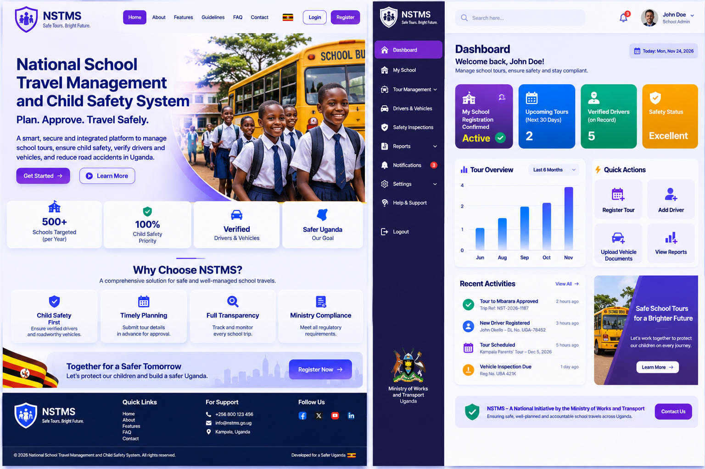

<div align="center">

# NSTMS

## National School Travel Management and Child Safety System

### **Plan. Approve. Travel Safely.**

**A proposed national digital platform for safer, more accountable school travel in Uganda.**


**BUILT WITH PURPOSE. DEVELOPED WITH PRECISION. DESIGNED FOR REAL-WORLD SCHOOL OPERATIONS.**

## </div>

## Product preview

[**View School App– Live Application**](https://pauldeveloper73.github.io/safe-trip-ug/)

## 

## 

---

## 1. Executive Overview

The **National School Travel Management and Child Safety System (NSTMS)** is a proposed digital platform designed to improve how school trips are planned, submitted, reviewed, coordinated and monitored in Uganda.

School trips provide valuable learning experiences, but transporting learners creates responsibilities that must be managed before a vehicle leaves the school. Schools need a clear process for submitting trip plans, identifying learners, obtaining parent or guardian consent, providing driver and vehicle information, arranging required checks and communicating with the relevant authorities. Parents need timely and reliable information. Authorised officers need a structured way to review submissions, coordinate inspections, record decisions and follow up on safety concerns.

NSTMS proposes to bring these activities into one coordinated platform. It is intended to connect schools, parents and guardians, drivers and transport providers, and authorised public-sector officers through role-specific portals and traceable workflows.

The project is positioned as a **public-interest child-safety and operational accountability solution**, not simply a school-trip booking application. Its long-term ambition is to support a consistent, transparent and measurable school-travel management process across Uganda.

> **Project status:** The current repository contains a static HTML/CSS user-interface prototype. It demonstrates the proposed public website, school dashboard, Ministry/national oversight dashboard, login screen and account-registration selection screen. It is not yet a live national service and does not currently process real registrations, approvals, inspections, payments, notifications or journey tracking.

## 2. The Problem

School travel involves several parties, documents and safety checks. Where these activities are handled through disconnected phone calls, paper records, messaging applications or last-minute arrangements, important information can be delayed, overlooked or difficult to verify.

NSTMS is designed to address challenges such as:

- **Limited trip visibility:** Relevant stakeholders may not have one reliable view of a school's planned journey, destination, departure time, return time, passenger numbers and assigned transport.
- **Transport verification gaps:** Driver details, licence information, vehicle documents, insurance evidence, inspection records and seating capacity may be submitted or checked through fragmented processes.
- **Late planning and review:** When trip information is submitted too close to the travel date, schools and responsible authorities may have insufficient time to review the plan or coordinate physical vehicle inspections.
- **Parent communication gaps:** Parents and guardians may not receive consistent information about a trip, the responsible school contacts, transport arrangements or changes to the schedule.
- **Weak record traceability:** Paper-based or informal processes can make it difficult to establish who submitted information, who reviewed it, what action was taken and when it occurred.
- **Inconsistent operational visibility:** School leaders and authorised agencies may lack consolidated information for monitoring trip readiness, identifying recurring gaps and planning safety interventions.

These are the operational problems NSTMS is intended to help solve. The platform must complement—not replace—physical inspections, professional judgement, statutory mandates and emergency-response services.

## 3. The Proposed Solution

NSTMS will provide a secure, role-based digital environment in which a school can prepare a trip submission early, provide the required learner and transport information, track outstanding requirements and communicate with parents or guardians.

The proposed workflow will allow authorised reviewers to examine submissions, request corrections, coordinate relevant checks, record inspection outcomes and make decisions within their legal authority. Schools will be able to see the status of their submissions and address issues before the planned departure date.

The system is intended to support the complete school-trip lifecycle:

1. **School onboarding:** A school submits its institutional details and the information required for account review.
2. **Trip planning:** The school records the purpose, destination, proposed route, dates, timings, learner numbers, supervising staff and emergency contacts.
3. **Learner and guardian records:** The school provides the minimum necessary learner manifest information and records parent or guardian consent in accordance with approved procedures.
4. **Transport submission:** The school identifies the proposed vehicle, driver and transport provider and submits relevant supporting documents.
5. **Completeness and compliance review:** The platform checks whether required fields and documents have been supplied and flags missing or expiring information. A digital completeness check is not an official verification.
6. **Authority review and inspection coordination:** Authorised personnel review the submission and arrange any required physical checks or referrals.
7. **Decision and correction tracking:** Reviewers record a decision, conditions, requests for additional information or reasons for non-approval. Decisions remain attributable to the responsible authorised officer.
8. **Parent communication and trip preparation:** Approved communication workflows provide parents or guardians with relevant trip information and updates.
9. **Journey monitoring and escalation:** The future production system can support scheduled check-ins, status updates, location sharing where lawful and feasible, and escalation of reported incidents.
10. **Trip closure and reporting:** The school records trip completion, exceptions and incidents, while authorised users retain appropriate records for audit and performance reporting.

**Core principle:** A system status such as “documents received” or “review completed” must never be presented as proof that a vehicle has passed a physical inspection or that a statutory authority has approved a trip unless the relevant authorised decision has actually been recorded.

## 4. Vision, Mission and Strategic Objectives

### Vision

To support a safer, more transparent and accountable school-travel environment for every learner in Uganda.

### Mission

To provide a secure national digital platform that helps schools plan responsibly, supports parents with timely information, improves transport-document traceability and enables authorised institutions to coordinate and monitor school-travel safety processes.

### Strategic objectives

- Encourage schools to submit trip plans sufficiently in advance for review and preparation.
- Improve the completeness and traceability of learner, driver, vehicle and trip information.
- Support parent and guardian awareness and consent workflows.
- Help authorised agencies coordinate document reviews, physical inspections and follow-up actions.
- Provide clear records of submissions, reviews, decisions, changes and incidents.
- Generate useful operational data for school leaders and authorised public-sector decision-makers.
- Establish a scalable digital foundation that can be rolled out in phases, subject to Government approval, funding and institutional readiness.

## 5. Stakeholders and Intended Value

| Stakeholder                                      | Intended value from NSTMS                                                                                                                        |
| ------------------------------------------------ | ------------------------------------------------------------------------------------------------------------------------------------------------ |
| **Schools and headteachers**                     | A structured place to plan trips, submit required information, track review status, manage learner lists and keep records.                       |
| **Parents and guardians**                        | Clearer access to trip information, consent requests, relevant updates and school contact details.                                               |
| **Drivers and transport providers**              | A process for submitting driver and vehicle information and tracking document or review requirements.                                            |
| **Education authorities**                        | Better visibility of school-trip submissions and the ability to coordinate school-level compliance workflows within their mandate.               |
| **Transport and road-safety authorities**        | Structured access to relevant transport submissions and inspection coordination records, subject to approved roles and integrations.             |
| **Police and emergency-response stakeholders**   | Potential access to appropriately authorised trip information or escalation workflows where formal agreements and operational procedures permit. |
| **Parents' associations and communities**        | Greater transparency around trip planning and communication responsibilities.                                                                    |
| **Government, funders and development partners** | A potential national coordination tool with measurable service-delivery, compliance and child-safety process indicators.                         |

NSTMS is intended to improve the quality and coordination of safety processes. It cannot guarantee that accidents will never occur, and it must not be marketed as doing so.

## 6. Proposed Platform Modules

The following modules describe the intended completed system. Some are represented visually in the current prototype; others require product design, backend development, institutional approvals or external integrations.

### 6.1 Public Information Website

- Project overview, purpose and benefits.
- Clear guidance on how schools, parents and transport providers use the platform.
- School registration and user sign-in entry points.
- Safety guidance, frequently asked questions and help information.
- Contact and stakeholder-engagement information.

### 6.2 School and Headteacher Portal

- School profile and institution records.
- Trip creation, editing, submission and status tracking.
- Destination, route, schedule and supervising-staff details.
- Learner manifest and guardian-consent status.
- Driver, vehicle and transport-provider assignment.
- Required-document checklist and expiry reminders.
- Inspection and review status.
- Trip readiness overview and outstanding-action list.
- Trip history, reports and incident submission.

### 6.3 Parent and Guardian Portal

- Secure access to relevant learner and trip information.
- Parent or guardian consent workflow.
- Trip schedule, destination and school contact information.
- Notifications about material trip changes, subject to consent and notification preferences.
- A way to raise a concern or report a safety issue through approved channels.

### 6.4 Driver and Transport Provider Portal

- Driver and transport-provider profile submission.
- Driver-licence information and supporting-document upload.
- Vehicle registration and supporting-document submission.
- Insurance and inspection evidence records.
- Document status and expiry notifications.
- Assigned trip information and permitted journey updates.

### 6.5 Ministry and Authorised Agency Workspace

- Role-specific review queues and trip-submission records.
- School, driver and vehicle information within authorised access boundaries.
- Inspection requests, assignments, outcomes and follow-up actions.
- District, regional and national operational summaries.
- Incident and exception reporting.
- Compliance indicators and exportable management reports.
- Detailed audit history for sensitive actions and official decisions.

Institutional responsibilities must be agreed before implementation. The software should support coordination across institutions without transferring or inventing statutory powers.

### 6.6 Platform Administration and Governance

- User, role and permission management.
- School and institution onboarding review.
- Configurable trip requirements and document categories.
- Controlled content and system configuration.
- Security monitoring, audit-event review and operational reporting.
- Data-retention, archival and account-management controls.

### 6.7 Notifications and Communications

The production platform may provide email, SMS and in-portal notifications for registration status, missing documents, approaching trip dates, inspection appointments, decisions, schedule changes and incident follow-up. Notification templates, delivery providers, consent rules and costs must be agreed before launch.

### 6.8 Journey Monitoring and Incident Management

A later implementation phase may introduce journey check-ins, location sharing, route-status reporting, emergency contacts and incident escalation. GPS information must only be collected when there is a clear lawful purpose, appropriate notice, proportionality, access control and an operational response process. The platform must not imply continuous live monitoring where that capability is not available.

## 7. Role-Based Access and Accountability

NSTMS is intended to use role-based access, with additional school, district, regional or agency-level data restrictions where required.

| Proposed role                    | Typical access boundary                                                                                 |
| -------------------------------- | ------------------------------------------------------------------------------------------------------- |
| Public visitor                   | Public information and registration entry points only.                                                  |
| School administrator/headteacher | Their own school's profile, users, trips and relevant learner/transport records.                        |
| School staff member              | Only the functions and records assigned by the school administrator.                                    |
| Parent/guardian                  | Only the learner and trip information for which the individual has a verified, authorised relationship. |
| Driver/transport provider        | Own profile, submitted documents and relevant assigned transport records.                               |
| District or local reviewer       | Records within the officer's formally assigned jurisdiction and mandate.                                |
| Authorised national officer      | Permitted national-level workflows and records according to approved responsibilities.                  |
| Platform administrator           | Technical administration under controlled, logged and limited privileged access.                        |

Access must be granted on a least-privilege basis. A platform administrator should not automatically have unrestricted access to learner data merely because they administer the technology.

## 8. Investor and Partnership Opportunity

NSTMS addresses a national operational need that crosses school administration, child safeguarding, transport coordination, public-sector oversight and digital service delivery.

The opportunity is to establish a scalable platform that can be piloted with a defined group of schools, validated with the relevant institutions and expanded in phases when the operating model, funding and governance are proven.

### Potential investment and partnership areas

- **Government sponsorship or procurement:** A public-sector commissioning model for a national service, subject to the applicable approval and procurement processes.
- **Public-private partnership:** A structured partnership for development, hosting, maintenance, support and service delivery, with clear accountability and data-governance terms.
- **Development-partner funding:** Support for discovery, pilot delivery, child-safety outcomes, digital public infrastructure and institutional capacity-building.
- **Strategic technology investment:** Funding for secure platform engineering, integrations, hosting, cybersecurity and product development.
- **Institutional pilot partnerships:** Participating schools, districts, transport operators and relevant authorities to validate workflows and operating requirements.
- **Integration partnerships:** Approved connections to relevant identity, licensing, vehicle, insurance, inspection, notification and mapping services where such interfaces are legally available.

### Funding and sustainability considerations

The original concept includes proposed registration charges of **UGX 5,000 per school** and **UGX 100 per driver**, with an initial target of **500 schools per year**. These are preliminary concept figures only; they are not approved tariffs, final prices or evidence of financial viability.

A national child-safety service should not depend on low registration charges alone to finance secure hosting, technical support, field inspections, integrations, cybersecurity, training and ongoing operations. The final funding model should be validated through a feasibility study and may combine Government funding, institutional service contracts, development-partner grants and other approved arrangements. Any fees must be transparent, affordable, legally authorised and designed not to discourage schools from following safety procedures.

### What an investor or partner is being invited to support

1. A formal discovery and feasibility phase with schools and relevant public institutions.
2. Detailed policy, operational and legal requirements for each participating institution.
3. A secure minimum viable product (MVP) for a controlled pilot.
4. Pilot deployment, user training, feedback and independent evaluation.
5. A phased national rollout plan supported by a sustainable operating and funding model.

No investment return, Government contract, institutional partnership or national mandate is implied by this concept document or by the current prototype. These require separate due diligence, negotiation and formal approval.

## 9. Implementation Roadmap

A phased delivery approach will reduce implementation risk and allow the project to be validated before national expansion.

| Phase                                                 | Focus                                                                                                                                            | Key outputs                                                                                          |
| ----------------------------------------------------- | ------------------------------------------------------------------------------------------------------------------------------------------------ | ---------------------------------------------------------------------------------------------------- |
| **1. Discovery and stakeholder alignment**            | Consult schools, parents, transport stakeholders and relevant authorities; document processes, legal responsibilities and operating constraints. | Validated requirements, stakeholder map, service blueprint, governance model and feasibility report. |
| **2. Product and technical design**                   | Define user journeys, data model, security architecture, integration strategy and service standards.                                             | Approved UX/UI, technical specification, threat model, privacy assessment and delivery plan.         |
| **3. MVP engineering**                                | Build core school, review, registration, records, notification and reporting workflows.                                                          | Tested MVP, role-based access, audit logging, operational documentation and support procedures.      |
| **4. Controlled pilot**                               | Pilot with selected schools and authorised reviewers in agreed locations.                                                                        | Pilot results, usability feedback, issue register, performance measures and revised operating model. |
| **5. Expansion and integration**                      | Expand by agreed regions and introduce formally approved integrations.                                                                           | Scaled infrastructure, trained users, integration controls and regional rollout reports.             |
| **6. National operations and continuous improvement** | Operate, monitor, support and improve the national service.                                                                                      | Service-level reporting, security reviews, product releases, training and annual evaluation.         |

A detailed costed implementation plan, delivery schedule and staffing model should be prepared after discovery. National rollout should not be committed to until the pilot demonstrates operational readiness and the required institutions approve their roles.

## 10. Recommended Production Technology

The present prototype is built with static HTML and CSS. The following is a recommended target architecture for a secure, maintainable production system; it is **not a description of technology already implemented in this repository**.

| Layer                  | Recommended technology                                                                   | Purpose                                                                        |
| ---------------------- | ---------------------------------------------------------------------------------------- | ------------------------------------------------------------------------------ |
| Frontend               | React, TypeScript and Vite                                                               | Component-based portals and maintainable application development.              |
| Styling and UI         | Tailwind CSS or a governed shared CSS design system                                      | Consistent responsive interfaces and reusable design tokens.                   |
| Backend/API            | Node.js with NestJS (or a well-structured Express API)                                   | Validated business logic, API security, workflow services and integrations.    |
| Database               | PostgreSQL                                                                               | Relational records, transactions, reporting and structured access control.     |
| Cache and jobs         | Redis with a background-job worker                                                       | Caching, queued notifications and scheduled processing.                        |
| Document storage       | Private S3-compatible object storage                                                     | Secure storage for submitted documents, with access-controlled download links. |
| Identity and access    | A mature identity provider or securely implemented authentication service                | Session management, MFA, password policies and privileged-user controls.       |
| Notifications          | Approved SMS and email providers                                                         | Transactional messages and operational alerts.                                 |
| Maps and location      | A suitable mapping/GPS provider, selected after requirements and cost review             | Route visualisation and optional, governed journey monitoring.                 |
| Deployment             | Docker-based environments and a managed cloud or approved Government hosting environment | Repeatable deployment, scaling and operational consistency.                    |
| CI/CD and code quality | GitHub, automated tests, linting and controlled deployment pipelines                     | Version control, review and release discipline.                                |
| Monitoring             | Centralised logs, metrics, alerts and error tracking                                     | Operational visibility and incident response.                                  |

Technology selection should be confirmed during technical design, considering Government hosting policies, data residency, connectivity, total cost of ownership, support capacity and integration constraints.

## 11. Security, Privacy and Child Safeguarding

NSTMS may process information about children, schools, guardians, drivers and vehicles. Security and privacy are therefore foundational requirements, not optional enhancements.

The production system should be designed and independently reviewed against applicable Ugandan data-protection, privacy, child-protection, education, transport and cybersecurity requirements. Specialist legal and regulatory review is required before live learner information is collected.

### Minimum security and privacy controls

- Collect only the information necessary for a clearly defined operational purpose.
- Establish and document the lawful basis and consent/notice process for each type of personal-data processing.
- Use strong authentication and multi-factor authentication for privileged and sensitive roles.
- Enforce least-privilege, role-based and organisation-scoped access on the server—not only in the user interface.
- Encrypt data in transit and at rest, including backups and stored documents.
- Use secure file-upload controls, file-type validation, malware scanning and private storage.
- Maintain tamper-resistant audit records for sign-ins, access to sensitive records, changes, reviews and official decisions.
- Apply secure session management, rate limiting, input validation, output encoding and protection against common web vulnerabilities.
- Set retention, archival and secure-deletion rules with the responsible institutions.
- Conduct vulnerability assessments, penetration testing and independent security reviews before production launch.
- Maintain tested backups, recovery procedures, incident response and breach-notification processes.
- Provide privacy-aware defaults and restrict learner information from public search engines and unauthorised users.
- Complete a data-protection/privacy impact assessment where required and review it when the system's purpose or data use changes.

### Important operational safeguards

- Digital document submission is not the same as verification against an official source.
- Automated reminders and completeness checks must not make statutory decisions.
- Physical vehicle inspections must be carried out and recorded by appropriately authorised personnel.
- A trip's approval status must identify the responsible authority and the recorded decision.
- Emergency procedures must identify who receives an alert, who is responsible for responding and what happens if a notification is not acknowledged.
- GPS or continuous location collection must not be activated without a documented lawful purpose and suitable governance.

## 12. Monitoring, Evaluation and Success Measures

The platform should measure process quality and adoption, not only the number of accounts created. Proposed indicators include:

- Number of schools onboarded and actively using the service.
- Number and proportion of trips submitted within the required lead time.
- Completeness of learner, guardian, driver, vehicle and trip records.
- Parent/guardian consent completion rates where applicable.
- Number of required inspections requested, completed and recorded before departure.
- Average time taken to review submissions and resolve outstanding actions.
- Number of expired, incomplete or rejected documents identified before travel.
- Number of incidents reported, acknowledgement times and follow-up completion.
- School, parent and authorised-officer satisfaction and usability feedback.
- Platform availability, support response, security events and recovery performance.

Baseline values, targets, reporting intervals and the responsible data owners should be agreed during the pilot. Safety outcomes must be assessed carefully and should not be attributed to the software without credible evidence.

## 13. Key Risks and Mitigation Approach

| Risk                                                | Mitigation approach                                                                                                    |
| --------------------------------------------------- | ---------------------------------------------------------------------------------------------------------------------- |
| Unclear institutional responsibilities              | Agree mandates, decision rights, escalation routes and data-sharing agreements before launch.                          |
| False or altered documents                          | Use approved verification channels where available; retain evidence, verification source, officer and timestamp.       |
| Low school or parent adoption                       | Co-design the service, provide training, use accessible interfaces and maintain practical support channels.            |
| Limited connectivity                                | Design for low-bandwidth use, resilient submissions and carefully governed offline options where justified.            |
| Privacy breach or unauthorised access               | Apply privacy-by-design, least privilege, encryption, security testing and an incident-response plan.                  |
| Delayed physical inspections                        | Coordinate inspection capacity, appointment workflows, escalation and realistic lead times.                            |
| Incomplete or inaccurate data                       | Use validation, clear responsibility for updates, exception queues and audit trails.                                   |
| Unsustainable operating costs                       | Complete a feasibility study and secure a multi-year funding and support model before national expansion.              |
| Overreliance on GPS or automated alerts             | Define fallback procedures and ensure human-led escalation and response.                                               |
| Misrepresentation as an approved Government service | Obtain written authority before using official branding, announcing a national mandate or processing official records. |

## 14. Current Repository: What Is Available Today

This repository is the **NSTMS frontend concept and visual prototype**. It provides a demonstration of the proposed user experience and shared design language.

### Included pages and assets

| Path                                    | Description                                                                                                             | Current status                                 |
| --------------------------------------- | ----------------------------------------------------------------------------------------------------------------------- | ---------------------------------------------- |
| `index.html`                            | Public landing page, project overview, benefits, workflow, FAQs and registration calls to action.                       | Static UI prototype.                           |
| `dashboard.html`                        | School administrator dashboard with overview cards, tour summary, quick actions, recent activity and readiness content. | Static UI prototype with illustrative records. |
| `ministry-dashboard.html`               | National oversight dashboard with sample submission queue, review indicators and inspection coordination content.       | Static UI prototype with illustrative records. |
| `login.html`                            | Sign-in screen concept.                                                                                                 | Form presentation only; no authentication.     |
| `register.html`                         | Registration and account-type selection screen.                                                                         | Form presentation only; no account creation.   |
| `css/styles.css`                        | Shared responsive styling, components, colour tokens and layout rules.                                                  | Implemented for the static prototype.          |
| `assets/school-trip-hero.jpg`           | Hero image used by the public landing page.                                                                             | Included local asset.                          |
| `assets/nstms-ui-reference-preview.png` | Reference image showing the intended public and dashboard visual direction.                                             | Included visual reference.                     |
| `README.md`                             | Project overview, setup instructions and implementation direction.                                                      | Current document.                              |

### What is not implemented yet

The current frontend does not include:

- JavaScript application logic or working CRUD operations.
- User registration, login, password reset, MFA or session management.
- API services, database persistence or multi-tenant data separation.
- Server-side permissions or secure user/role administration.
- Real driver-licence, vehicle-registration, insurance or inspection verification.
- Live trip approval, official review decisions or statutory authorisation.
- Parent consent processing or transactional SMS/email notifications.
- Payment collection, fee reconciliation or financial reporting.
- GPS tracking, dispatch, emergency response or incident case management.
- Production audit logging, security monitoring, backups or disaster recovery.
- Government identity, education, transport, police or other external-system integrations.

Dashboard names, numbers, dates, references, statuses and activities are sample content for visual demonstration. They must not be treated as live operational records.

## 15. Run the Prototype Locally

The current prototype is static HTML/CSS and does not require a frontend build process.

### Option A: Visual Studio Code

1. Download or clone the project folder.
2. Open the folder in Visual Studio Code.
3. Open `index.html` with the Live Server extension, or use another local static-file server.
4. Navigate between the landing page, login, registration and dashboard pages using the provided links.

### Option B: Python local server

From the project directory, run:

```bash
python -m http.server 5500
```

Then open:

```text
http://localhost:5500
```

The public landing page is `index.html`. The school and national oversight workspaces can be opened directly using `dashboard.html` and `ministry-dashboard.html`.

## 16. Project Structure

```text
SafeTrip_Uganda_Frontend/
├── index.html
├── dashboard.html
├── ministry-dashboard.html
├── login.html
├── register.html
├── README.md
├── css/
│   └── styles.css
└── assets/
    ├── school-trip-hero.jpg
    └── nstms-ui-reference-preview.png
```

## 17. Design Direction

The interface follows a consistent visual identity intended to communicate trust, safety, clarity and institutional credibility.

| Design token  | Value     | Use                                                         |
| ------------- | --------- | ----------------------------------------------------------- |
| Deep navy     | `#081342` | Main navigation, dashboard sidebar and high-contrast areas. |
| Navy          | `#111b57` | Core brand and heading colour.                              |
| Royal purple  | `#672fe9` | Primary actions, active navigation and brand highlights.    |
| Blue          | `#1169ef` | Information and selected operational indicators.            |
| Teal          | `#05a88a` | Positive status and safety-related highlights.              |
| Amber         | `#f4a300` | Pending, warning and attention states.                      |
| Pale lavender | `#f2f1ff` | Page backgrounds and soft visual surfaces.                  |
| White         | `#ffffff` | Cards, forms and content surfaces.                          |

**Typography:** Plus Jakarta Sans with system fallbacks.

The shared stylesheet is designed for desktop, tablet and mobile layouts and includes visible keyboard focus treatment, reduced-motion support and semantic page structure. The design should remain consistent across future parent, driver, school, district and national workspaces.

## 18. Governance and Official Status

NSTMS is currently a proposed project concept and frontend demonstration. The presence of Ministry-related interface screens does not establish a Government partnership, Ministry approval, official national deployment or access to Government databases.

Before public-sector deployment, the project will require the relevant institutional approvals, documented operating procedures, legal and privacy review, formal data-sharing arrangements, procurement or partnership approvals, and authorisation for any official logos, seals or branding. External integrations must use formally approved interfaces and credentials.

The platform should be developed with the relevant education, transport, road-safety, data-protection and local-government stakeholders. Final institutional ownership, hosting arrangements, support responsibilities and decision-making powers must be agreed before the service is represented as a national Government system.

## 19. Collaboration and Engagement

NSTMS is open to structured discussions with stakeholders who can contribute to validation, funding, implementation and responsible deployment.

**Potential engagement areas:**

- Government and institutional stakeholders interested in improving school-travel coordination.
- Investors and development partners exploring child-safety and digital public-service initiatives.
- Schools interested in participating in discovery sessions or a controlled pilot.
- Transport operators and professional associations interested in safer school-transport processes.
- Technology providers offering secure hosting, identity, notification, mapping or verification services.
- Implementation partners supporting cybersecurity, service design, training, monitoring and evaluation.

For a useful first discussion, please share your organisation, the problem you want to address, the role you may play, your key requirements and your preferred engagement timeline.

## 20. Developer and Project Contact

**Kisakye Paul — Software Developer & Project Owner**

I design and develop websites, web applications and custom digital solutions with an emphasis on practical workflows, thoughtful user experience, maintainable architecture and software that addresses real operational needs.

- **Email:** [kisakyepaul73@gmail.com](mailto:kisakyepaul73@gmail.com)
- **WhatsApp:** [Contact Kisakye Paul](https://wa.me/256774185964)
- **GitHub:** [github.com/pauldeveloper73](https://github.com/pauldeveloper73)
- **Portfolio:** [Explore the developer portfolio](https://pauldeveloper73.github.io/Kisakye-Paul-Elite-Portifolio/)

For school software enquiries, custom web applications, workflow automation or an NSTMS implementation discussion, use the contact links above. Please include your organisation, requirements and preferred timeline so the enquiry can be assessed appropriately.

### Let's discuss a safer, more accountable approach to school travel.

**[Email Kisakye Paul](mailto:kisakyepaul73@gmail.com) · [Start a WhatsApp discussion](https://wa.me/256774185964) · [View developer portfolio](https://pauldeveloper73.github.io/Kisakye-Paul-Elite-Portifolio/)**

---

<div align="center">

**BUILT WITH PURPOSE. DEVELOPED WITH PRECISION. DESIGNED FOR REAL-WORLD SCHOOL OPERATIONS.**

© Kisakye Paul — NSTMS Project Concept and Frontend Prototype. All rights reserved, subject to the repository's applicable licence and third-party terms.

</div>

> **Use and licensing note:** No open-source licence is declared by this README. Unless a separate licence or written permission says otherwise, do not assume that the source code, project branding or visual assets may be copied, redistributed or commercially reused. Third-party components and assets remain subject to their respective terms.
